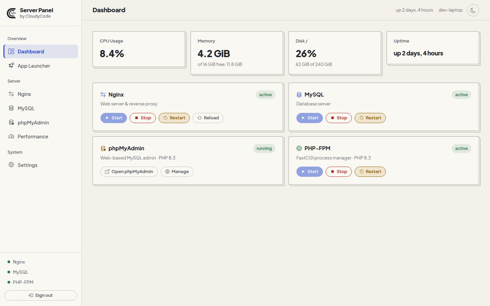
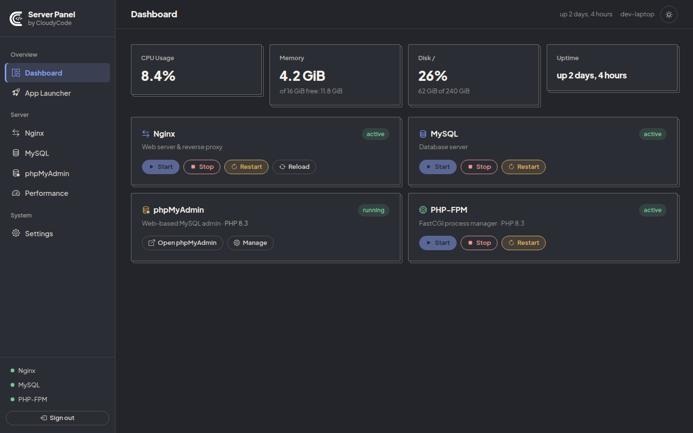

# CloudyCode Server Panel

CloudyCode Server Panel is a localhost dashboard for managing a Linux development stack and its web applications with a standard-library Python backend.





## What it does

- **Dashboard and services** show CPU, memory, disk and uptime, with controls for Nginx, MySQL and PHP-FPM.
- **App Launcher** groups WordPress, Laravel, CodeIgniter 4 and plain PHP projects. Install wizards show live progress and attempt to roll back resources created by a failed installation.
- **WordPress** can update selected sites with a shared cached official archive. Use **Update WordPress core** to apply the cached release to eligible sites. An optional per-site plugin generates one-use WordPress admin login links.
- **Nginx** lists virtual hosts, enables or disables sites, edits and validates configuration, and shows access and error logs.
- **MySQL** lists, creates and drops databases and runs SQL queries. **phpMyAdmin** has controls for installation, Nginx setup and configuration.
- **Performance** edits selected settings for Nginx, PHP, PHP-FPM and MySQL.
- **Settings** updates the panel username, password and MySQL connection credentials. The interface supports light and dark themes.
- **MCP** exposes panel operations to Claude Code, Codex and OpenCode.

[App Launcher](docs/screenshots/apps-light.png) · [WordPress](docs/screenshots/wordpress-light.png) · [Nginx](docs/screenshots/nginx-dark.png) · [Mobile dashboard](docs/screenshots/mobile-dashboard-light.png)

## Requirements

- Ubuntu, Debian or a compatible Linux distribution
- Python 3.8 or later
- Nginx, MySQL or MariaDB, and PHP-FPM for the managed stack
- Optional tools include phpMyAdmin, Composer for Laravel and CodeIgniter installs, and WP-CLI for WordPress admin password changes

## Install

Run as your normal Linux user.

```bash
git clone https://github.com/VJ-Ranga/server-panel.git
cd server-panel
./install.sh
```

The installer checks for stack dependencies and prints installation hints. It prompts for a panel username, password and confirmation. Press Enter at all three prompts for `admin` / `admin`. If a panel login is already configured, you can keep it. The installer offers to set up sudo rules, add a desktop launcher and enable autostart at desktop login.

Use `./install.sh --yes` to accept the defaults. It keeps an existing login or sets `admin` / `admin`, adds the desktop launcher and leaves autostart off. Sudo setup runs non-interactively and the installer prints the manual command if it needs to be completed later.

Start the panel from the desktop launcher or run `./start-panel.sh`.

For manual setup, run these commands from the repository directory. Stop a foreground panel with Ctrl+C.

```bash
sudo bash setup-sudo.sh "$USER" "$PWD"
python3 panel.py
```

## First login

Open [http://127.0.0.1:8765](http://127.0.0.1:8765) on the machine running the panel. Sign in with the credentials you set during installation. The defaults are username `admin` and password `admin`. Change them in **Settings**.

## Security model

The panel binds to `127.0.0.1` for use on a single-user development machine. Keep it on loopback and do not expose it to a network. Change the default credentials before use.

Sudo access is defined in `/etc/sudoers.d/server-panel`. The rules cover specific project helper scripts and direct commands for service control, database operations, Nginx, and phpMyAdmin. Keep the generated local configuration private. Opening and closing the panel in the browser can start and stop services on the machine.

## AI agents (MCP)

The Python MCP bridge sends authenticated localhost HTTP requests to a running panel. Configure your client to request confirmation before invoking tools that modify services, sites or databases. Setup and tool details are in the [MCP guide](mcp/README.md).

## Project layout

| File or directory | Purpose |
| --- | --- |
| `panel.py` | Local HTTP server, authentication, JSON API and background jobs |
| `index.html`, `assets/` | Single-file Bootstrap and vanilla JavaScript UI, plus local assets |
| `install.sh`, `setup-sudo.sh` | Interactive setup and generation of sudo rules |
| `start-panel.sh`, `panel-icon.svg` | Desktop launcher entry point and icon |
| `wp-install-helper.sh`, `wp-delete-helper.sh` | Privileged WordPress install, core update, port change and deletion operations |
| `wp-auto-login-plugin.php`, `wp-plugin-library/` | One-use WordPress auto-login plugin and local plugin ZIP library |
| `laravel-helper.sh`, `codeigniter-helper.sh`, `php-project-helper.sh` | Privileged filesystem and Nginx operations for each app type |
| `perf-helper.sh` | Applies supported performance configuration changes |
| `panel_config.json` | Generated, Git-ignored settings and credentials |
| `mcp/server_panel_mcp.py`, `mcp/README.md` | MCP bridge and client setup guide |
| `scripts/demo_server.py` | Standalone localhost demo with fake data and disabled changes |
| `scripts/make_screenshots.sh`, `docs/screenshots/` | Headless Chrome capture script and demo PNGs |
| `tests/` | Automated regression tests |

## Development

Run the tests with pytest installed.

```bash
python3 -m pytest -q
```

Preview the UI with fake data using the demo server.

```bash
python3 scripts/demo_server.py
```

Open [the demo dashboard](http://127.0.0.1:8799/?theme=light#dashboard). Use `--port` to choose another loopback port and `?theme=dark` for dark mode. The UI loads Bootstrap and Bootstrap Icons from a CDN.

To regenerate the six screenshots with Google Chrome, run:

```bash
./scripts/make_screenshots.sh
```

Set `CHROME_BIN` if Chrome is installed under a different command. The script starts a demo on a temporary loopback port and stops it after capture.

## License

License: not yet chosen.
